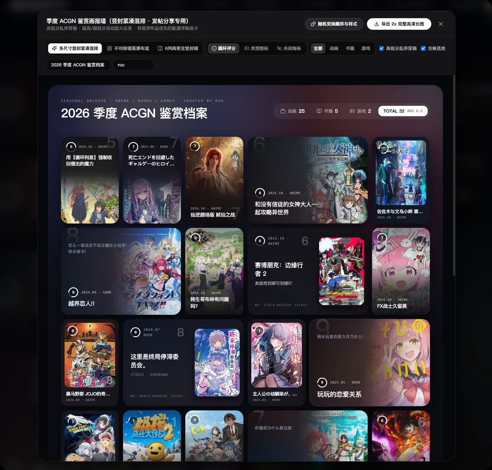

<div align="center">

# BGM AniTier

**把 Bangumi 收藏拖成一座可以晒出来的动画神殿。**

个人 ACGN 分级 · 主观漫评墙 · AI 品味报告 · 录屏小剧场

[在线体验](https://bgm-anitier2026.pages.dev/) · [Releases](https://github.com/ikemenrourou/BGM-AniTier/releases) · [功能](#功能) · [快速开始](#快速开始) · [部署](#部署) · [项目结构](#项目结构)

[](https://react.dev)
[](https://www.typescriptlang.org/)
[](https://vite.dev/)
[](https://tailwindcss.com/)
[](https://bgm-anitier2026.pages.dev/)
[](https://github.com/ikemenrourou/BGM-AniTier/releases)

</div>


> 没有公共评分，没有热门榜 KPI。只有你的给分、你的短评、你的双标，以及一条会拿这些数据开涮的鲸鱼。

## 这是什么

BGM AniTier 是一个**本地优先**的个人 ACGN 品味工作台。它把「整理收藏」和「把收藏晒出来」之间的脏活串成了一条线：

1. 从 Bangumi 搜索 / 同步作品，拖进 1–10 分档位，可选 0.5 细分；
2. 写短评、看 Tag 偏好，把榜单变成主观漫评墙和季度画报；
3. 把你的真实给分交给 AI 评论员，生成带 HTML 视觉卡片的深度锐评；
4. 把榜单、画报和小剧场导出成可以直接发帖的 PNG；报告留在页面里，截图也好看。

它适合：

- 想把 Bangumi 收藏认真排一次，而不是只在心里排的人；
- 做漫评 / 排榜视频，需要好看的长图和双人台词的人；
- 想让 AI 拿自己真实数据开涮，而不是生成正确废话的人；
- 喜欢暗色玻璃、票根、Bento 卡片和「这 7.5 到底该放哪」的人。

它不适合：

- 想要公共评分社区、关注数和排行榜的人；
- 想要账号体系、跨设备云同步的人；
- 完全不想碰 API key、只想开箱看别人榜单的人。

**新浏览器打开是空的。** 没有预置作品、短评、报告或台词，这是设计，不是 bug。

## 功能

### 01 · Tier List：把「我觉得」排成十层

主看板是整件东西的原点。

- 1–10 整数档位默认全开；0.5 半分档按榜单单独开启。
- 跨档拖拽、同档排序、批量传图、待排候选池。
- Bangumi 关键词搜索、按年 / 季度浏览新番、手动添加自定义条目。
- 「BGM 追番同步」导入收藏，「回写打分」把结果推回 Bangumi。
- Tag 偏好统计：高频标签、平均给分，点击标签高亮对应作品。
- 6 种个人短评卡排版（封面色浆羽化构图）；档位弥散光毛玻璃、渐变主题或自定义背景。
- 榜单长图导出，可只导出非空 Tier。

### 02 · 主观漫评墙：把榜单拆成一墙票根


拿掉档位标签之后，作品只剩封面、分数和那句短评——反而更像一个人真实的品味现场。

- 6 种无痕羽化渐变构图，随机混排卡片大小与位置。
- 有短评的作品优先获得更大的展示面积。
- 高分与低分可以刻意穿插，制造「这人到底什么审美」的反差。
- 适合直接截图 / 录屏，或作为排榜视频的背景；卡片构图可以一键随机混排。

### 03 · AI 品味报告：让鲸鱼娘拿数据开涮


报告不是「总结一下我的榜单」，而是把你的给分、短评、角色偏好和 Bangumi 社区数据放在一起审。

- 5 位内置评论员：**鲸鱼娘**、**婆罗门 zako**、**元气猫娘**、**亚托莉**、**派大星**。
- 自动读取作品 Infobox、角色人气、角色页热评与 BGM 网友吐槽；接口受限时降级为基础数据。
- 支持 Gemini，也支持 OpenAI 兼容接口；浏览器直连或走本地 Express 代理。
- 流式生成，报告里可以直接出现 `<anitier-view>` HTML 视觉卡片：化验单、吐槽楼、颁奖台、聊天记录。
- 封面 `{{cover:作品名}}`、角色 `{{char:角色名}}`、评论员头像 `{{avatar}}` 会自动替换成真实图片。
- 前端卡片超出范围时会安全降级为普通正文，不会让整篇报告挂掉。

**两套独立鲸鱼娘人设**：报告用 `FEIYU_DEFAULT_PERSONA_PROMPT`，小剧场用 `FEIYU_STUDIO_PERSONA_PROMPT`。互不继承，避免小剧场的损友口吻污染深度专栏。旧版原厂人设会按指纹升级，自定义人设不会被覆盖。

<details>
<summary><strong>内置 11 条世界书</strong>（点击展开）</summary>

| 词条 | 作用域 | 默认 |
| --- | --- | --- |
| 通用 ACGN 知识库 | 两边通用 | 开 |
| 载体前端可视化 (`<anitier-view>`) | 仅报告 | 开 |
| 输出规范 | 仅报告 | 开 |
| 双人录屏搭档定位 | 仅小剧场 | 开 |
| 互联网讽刺与生草造梗学 | 两边通用 | 开 |
| 🎙️去八股 | 仅小剧场 | 开 |
| 🎙️Bangumi数据捕食与认知门控 | 仅小剧场 | 开 |
| ⚡ 嘴臭DLC(可选) | 两边通用 | 关 |
| ⚡ 阴阳怪气DLC(可选) | 两边通用 | 关 |
| ⚡ XP拷打(可选) | 两边通用 | 关 |
| 🎙️熟人连麦陪看腔 | 仅小剧场 | 开 |

三条 DLC 默认关闭，避免「发癫」「冷脸」「XP 审判」同时上桌互相打架。词条可以逐条开关，也可以调整插入位置、优先级和作用域。

</details>

### 04 · 录屏小剧场：给排榜视频一个片场


把 Tier List 当背景，让角色在 16:9 舞台上一边看榜一边斗嘴。

- 双人对话，时间线式台本，主持人与搭档可分别设置表情差分。
- 内置常驻角色：**鱼**（数据海洋活宝 · 主食白米饭）、**婆罗门 zako**、**亚托莉**。
- 语音预设、逐字气泡、打字机节奏、说话音效。
- 场景图、开场 / 收尾、世界书、Prompt 预览与实际拼装结果。
- 把手账对话导出成多页贴纸卡片 PNG；角色卡可单独导出 PNG（内嵌人设、差分与世界书）。
- 小剧场与报告共用作品 / 角色数据，但人设和世界书作用域彼此隔离。

### 05 · 季度 ACGN 画报：把一年折成一张长图


这是给「发帖分享」准备的功能，不是给数据库看的。

- 按年份 / 季度筛选，动画、书籍、游戏可以混合或分开。
- 三种排版：多尺寸竖封面瀑布流、不对称错落瀑布流、6 列高密全竖封。
- 高低分乱序穿插，超高分 / 低分自动放大；可选环形评分、类型图标、隐藏标题。
- 一键导出 2× 完整长图，保留当前筛选与排版。
- 画报生成器带独立导出面板，可以先预览再出图。

<details>
<summary><strong>查看画报生成器 / 导出面板</strong></summary>



</details>

### 06 · 数据与备份：你的榜单只属于你

- 本地使用 IndexedDB（`bgm-anitier-user-data-v1`）保存，并镜像到 `.data/user-state.json`。
- 设置里可导出全量 JSON 备份，包含榜单、短评、小剧场台本、角色差分、配图、世界书、开场收尾和语速。
- 导入前自动保留恢复点，可「恢复到上次导入之前」。
- Cloudflare 静态版只在浏览器保存，没有服务器存档或跨设备同步。
- 备份里包含 API Key / Token，**把它当密码，不要公开分享**。

## 快速开始

### 环境

- Node.js 20+
- npm 10+
- 可选：Bangumi Access Token、Gemini API Key 或任意 OpenAI 兼容接口

```bash
git clone https://github.com/ikemenrourou/BGM-AniTier.git
cd BGM-AniTier
npm install
cp .env.example .env
npm run dev
```

Windows PowerShell 把 `cp` 换成：

```powershell
Copy-Item .env.example .env
```

打开 **http://127.0.0.1:3000**。

`.env` 不是必填。AI Key 和 Bangumi Token 都可以在应用设置里填；`.env` 只是服务端兜底。

### 环境变量

| 变量 | 用途 |
| --- | --- |
| `GEMINI_API_KEY` | 服务端 Gemini Key；不填也可以在界面里用自己的 Key |
| `BGM_ACCESS_TOKEN` | Bangumi 兜底 Token；用于同步收藏 / 回写打分 |
| `PORT` / `HOST` | 本地服务监听地址，默认 `127.0.0.1:3000` |
| `BGM_DATA_DIR` | 服务端镜像目录，默认 `.data` |
| `STORAGE_BODY_LIMIT` | 存档请求体大小限制 |
| `DISABLE_HMR` | 设为 `true` 关闭 Vite HMR |

### 常用命令

| 命令 | 作用 |
| --- | --- |
| `npm run dev` | 启动 Express + Vite 开发服务 |
| `npm run lint` | TypeScript 类型检查（`tsc --noEmit`） |
| `npx tsx --test src/lib/*.test.ts` | 运行全部单元测试（`node:test`） |
| `npm run build` | 本地 / 自托管生产构建，输出 `dist/` |
| `npm run build:cf` | Cloudflare Pages 静态构建，输出 `dist-static/` |
| `npm start` | 启动 Express；`NODE_ENV=production` 时服务 `dist/` |
| `npm run clean` | 删除 `dist/` |

没有 `npm test` 脚本；测试统一用上面的 `tsx --test` 命令。

## 部署

### 本地 / 自托管

```bash
npm run build
NODE_ENV=production npm start
```

`dist/` 包含 `public/` 下的本地媒体。它适合自己的电脑或私有服务器，**不要**把带个人素材的 `dist/` 直接传到公开静态站。

### Cloudflare Pages

```bash
npm run build:cf
```

产物是 `dist-static/`。把这个目录复制到仓库外的独立发布文件夹，再执行：

```powershell
wrangler pages deploy . --project-name bgm-anitier2026 --branch main
```

几条硬规矩：

- 不要从仓库根目录直接 `wrangler pages deploy .`，否则容易把 `.data/`、`.env`、旧 `functions/` 一起带上。
- 不要上传 `.data/`、`.env`、全量备份、`public/assets/aistudio/` 的个人媒体。
- `dist-static/` 使用 `cloudflare/pages/` 作为 `publicDir`，只带 `_worker.js` 和 `_routes.json`，不包含个人 AI Studio 素材。
- 静态版没有服务器存档；作品、短评、报告、台词都只存在当前浏览器。
- 线上 AI 请求由浏览器直接发起，接口必须允许 CORS；Cloudflare 版没有服务端 Key 可代填。

Cloudflare 上唯一的服务端代码是 `cloudflare/pages/_worker.js`：它只代理 Bangumi 公开吐槽（`GET /api/public-comments/subjects/:id` 和 `/characters/:id`），固定上游、不带 Token / Cookie、不写数据、短缓存。其他请求仍由静态文件直接提供。

## 项目结构

```text
.
├── server.ts                      # Express + Vite 中间件、Bangumi / AI 代理
├── src/
│   ├── App.tsx                    # 页面状态与主容器
│   ├── types.ts                   # 共享类型
│   ├── components/                # 看板、搜索、报告、小剧场、设置等 UI
│   └── lib/                       # 纯逻辑、存储、Bangumi 客户端、Prompt 与导出
│       ├── tierLogic.ts           # 档位、标签、Prompt、世界书、角色预设
│       ├── studioDirector.ts      # 小剧场角色 / 表情 / 语音 / 提示词规则
│       ├── feiyuPersona.ts        # 报告 / 小剧场两套鲸鱼娘人设
│       ├── appStorage.ts          # IndexedDB + 服务端镜像
│       ├── bangumiApi.ts          # Bangumi v0 / next 客户端
│       └── *.test.ts              # 对应模块的单元测试
├── cloudflare/pages/              # Cloudflare Pages Worker 与路由
├── docs/screenshots/              # README 截图
├── public/                        # 本地媒体（不进静态构建）
└── .data/                         # 本地服务端存档（gitignored）
```

## 技术栈

| 层 | 选择 |
| --- | --- |
| UI | React 19、TypeScript 5.8、Tailwind CSS 4、motion、lucide-react |
| 构建 | Vite 6 |
| 本地服务 | Express 4 + Vite middleware |
| 存储 | IndexedDB + `.data/user-state.json` 镜像 |
| 数据 | Bangumi API v0 / `next.bgm.tv` |
| AI | Gemini API / OpenAI 兼容接口，流式输出 |
| 导出 | `html-to-image` + Canvas |
| 部署 | Cloudflare Pages + Pages Worker |

## 数据与隐私

- 没有账号、没有服务端用户库、没有跨设备同步；每个人在自己的浏览器里排自己的榜。
- 本地服务只镜像存档到 `.data/`，方便换浏览器或备份恢复，不会上传到第三方。
- 公开吐槽代理只读 Bangumi 公开数据，不转发用户 Token、Cookie 或输入。
- 作品封面、角色立绘、网友评论版权归 Bangumi 与各自权利方所有；本项目只做个人浏览、排版与分享展示。
- 本项目是个人项目，未附带开源许可证。代码和文案仅供学习参考；如果要复用或商用，请先联系作者。

## 常见问题

<details>
<summary><strong>BGM 同步失败 / 401</strong></summary>

在设置里检查 Bangumi Access Token 是否过期，或 `BGM_ACCESS_TOKEN` 是否写对。Bangumi API 有频率限制，连续同步大量收藏时先等一会儿再试。
</details>

<details>
<summary><strong>AI 请求 403 / CORS 报错</strong></summary>

如果你填的是 OpenAI 兼容接口，它必须允许浏览器跨域访问。可以改用本地 Express 的 Gemini 路由，或换一个支持 CORS 的兼容服务。Cloudflare 静态版没有服务端代填，必须由浏览器直连。
</details>

<details>
<summary><strong>导出的 PNG 缺封面 / 角色图</strong></summary>

通常是外链图片的 CORS 限制。可以先把封面下载到本地再上传，或换一个允许跨域的图源后重试。报告里的 HTML 卡片如果加载失败会降级为普通正文，不会让整篇报告消失。
</details>

<details>
<summary><strong>换电脑 / 换浏览器后数据没了</strong></summary>

IndexedDB 是按浏览器隔离的。先在旧设备导出全量 JSON 备份，再到新设备导入。Cloudflare 版没有服务器存档，更不能只靠清理缓存后的浏览器。
</details>

<details>
<summary><strong>为什么打开是空的？</strong></summary>

这是刻意的。项目不预置作品、短评、报告或台词；用「添加作品」「BGM 追番同步」或导入备份开始。
</details>

<details>
<summary><strong>改了默认世界书 / 人设，旧存档没更新</strong></summary>

在对应面板点「恢复默认」。只会升级可识别的原厂预设，自定义词条、人设标题和自定义内容会保留。
</details>

## 致谢

- [Bangumi 番组计划](https://bgm.tv/)：作品、角色、收藏与公开吐槽数据。
- React、Vite、Tailwind CSS、Express、Cloudflare Pages 及所有依赖的作者。
- 所有被拖进榜单的作品与角色。封面和立绘的版权属于原作者与权利方。

<div align="center">

<sub>给那些真的在意 7.5 该放哪一层的人。</sub>

</div>
