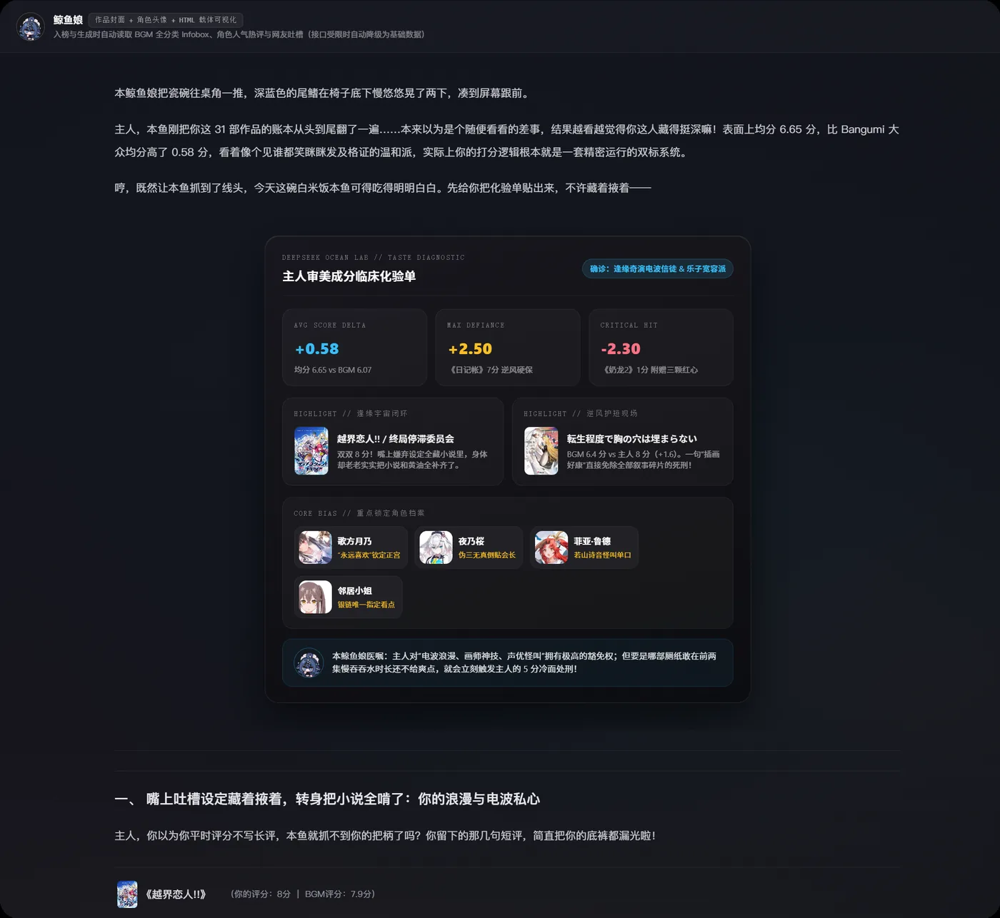
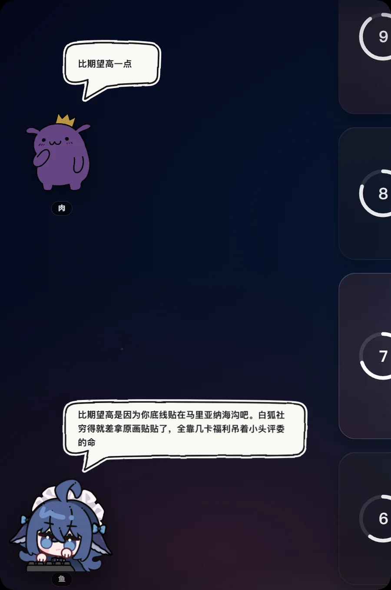

<div align="center">

# BGM AniTier

**把 Bangumi 收藏拖成一座可以晒出来的动画神殿。**

个人 ACGN 分级 · 主观漫评墙 · AI 品味报告 · 录屏小剧场

<p>
  <a href="https://bgm-anitier.pages.dev/"><strong>🌐 直接在线使用 →</strong></a><br />
  <sub>无需安装，打开浏览器即用。</sub>
</p>

[Releases](https://github.com/ikemenrourou/BGM-AniTier/releases) · [功能](#功能) · [本地运行](#本地运行) · [部署](#部署)

[](https://react.dev)
[](https://www.typescriptlang.org/)
[](https://bgm-anitier.pages.dev/)
[](https://github.com/ikemenrourou/BGM-AniTier/releases)

</div>

[](https://bgm-anitier.pages.dev/)

## 功能

| 功能 | 说明 |
| --- | --- |
| **Tier List** | 1–10 分 + 可选 0.5 档；跨档拖拽、批量传图、Bangumi 搜索 / 收藏同步 / 回写打分、Tag 统计、6 种短评卡。 |
| **主观漫评墙** | 6 种封面渐变与不对称瀑布流，随机混排你的短评。 |
| **AI 品味报告** | 5 位评论员 + 11 条可调世界书；读取真实 Bangumi 数据，流式生成带 HTML 诊断卡的锐评。 |
| **录屏小剧场** | 双人对话、表情差分、语音、气泡、场景；手账卡片 / 角色卡 PNG 导出。 |
| **季度 ACGN 画报** | 3 种排版，高低分乱序，2× 完整长图导出。 |

## 截图

| AI 品味报告 | 录屏小剧场 |
| :---: | :---: |
|  |  |
| **主观漫评墙** | **季度 ACGN 画报** |
|  |  |

## 在线使用

**https://bgm-anitier.pages.dev/**

打开即用，不需要安装。榜单、短评、报告和小剧场都在浏览器里运行；线上版没有服务器存档，换设备前先在设置里导出全量备份。

## 本地运行

```bash
git clone https://github.com/ikemenrourou/BGM-AniTier.git
cd BGM-AniTier
npm install
npm run dev
```

打开 http://127.0.0.1:3000。AI Key 和 Bangumi Token 都可以在设置里填；`.env` 可选。

## 部署

- 本地 / 自托管：`npm run build`，`NODE_ENV=production npm start`。
- Cloudflare Pages：`npm run build:cf`；把 `dist-static/` 复制到仓库外，再执行 `wrangler pages deploy . --project-name bgm-anitier --branch main`。
- 不要在仓库根目录直接部署，避免带上 `.data/`、`.env` 和个人素材。

## 数据与备份

- 本地版：IndexedDB + `.data/user-state.json` 镜像。
- 线上版：只保存在当前浏览器，没有服务器存档。
- 设置里可导出 / 导入全量 JSON；备份含 API Key 和 Token，请勿公开分享。

## 开发

`npm run lint` 类型检查 · `npx tsx --test src/lib/*.test.ts` 单元测试 · `npm run build:cf` 静态构建。

React 19 · TypeScript · Vite 6 · Tailwind CSS 4 · Express · IndexedDB · Bangumi API · Cloudflare Pages

## 致谢

[Bangumi 番组计划](https://bgm.tv/) 的作品、角色、收藏与公开吐槽数据。封面与立绘版权归原作者与权利方所有。

## 许可

[MIT](LICENSE)
